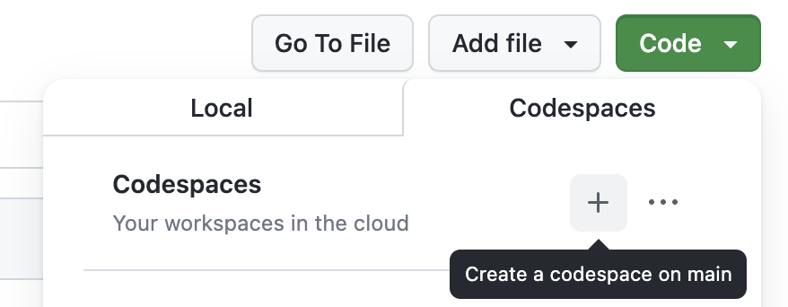
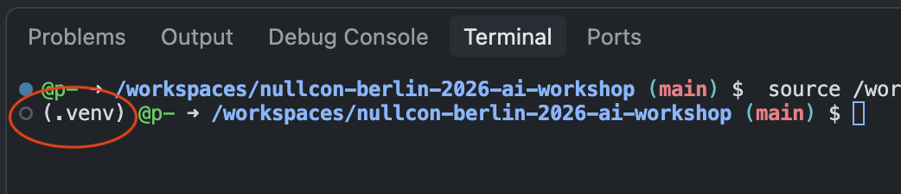

# Nullcon Berlin 2026 AI Workshop: Build Your Own Audit Workflow


## Setup

### Prerequisites

* Stable internet connection throughout the workshop.
* GitHub account ([sign up](https://github.com/) for free)
* Browser or [Visual Studio Code](https://code.visualstudio.com/download) (VS Code) with the [GitHub Codespaces](https://marketplace.visualstudio.com/items?itemName=GitHub.codespaces) extension installed on your local machine.

Note: The first 120h hours per core of Codespace usage are free per month, you can use a codespace with 2 or 4 cores for this workshop.

### Step-by-Step

1. Login to your [GitHub](https://github.com/login) account
2. On this repo: Click on Code -> Codespaces
3. Click on the plus sign (+) to create a new codespace.



=> VS Code will start in your browser and a remote Codespace will be built (this may take some time).

4. Wait until the Python virtual environment is activated, it should look like this:




## Exercise 1: Run Globals sample

```bash
python -m seclab_taskflow_agent -t ai_workshop.taskflows.ex1_globals -g fruit=apples
```


## Exercise 2: Find variants of past vulnerabilities or incomplete fixes

### Run existing fetch source code taskflow

Execute existing [`fetch_source_code`](https://github.com/GitHubSecurityLab/seclab-taskflows/blob/main/src/seclab_taskflows/taskflows/audit/fetch_source_code.yaml) taskflow from [seclab-taskflows](https://github.com/GitHubSecurityLab/seclab-taskflows/) repo. (Those taskflows are linked as dependency)
```bash
python -m seclab_taskflow_agent -t seclab_taskflows.taskflows.audit.fetch_source_code -g repo=pallets/flask
```

### Run existing fetch security advisory taskflow

```bash
python -m seclab_taskflow_agent -t seclab_taskflows.taskflows.audit.fetch_security_advisories -g repo=pallets/flask
```

### Run the changed variant finder fetch security advisory taskflow


```bash
python -m seclab_taskflow_agent -t ai_workshop.taskflows.ex2_variant_finder -g repo=pallets/flask
```


### Prompt to create new tool (MCP server)

```
Based on the variant_report toolbox create a new one named variant_report_json that writes the same content in JSON format. variant_exists should be reflected as boolean field.
```